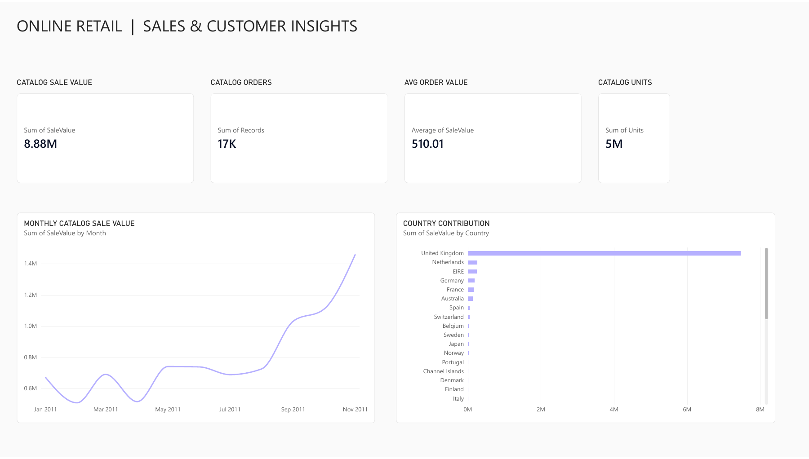
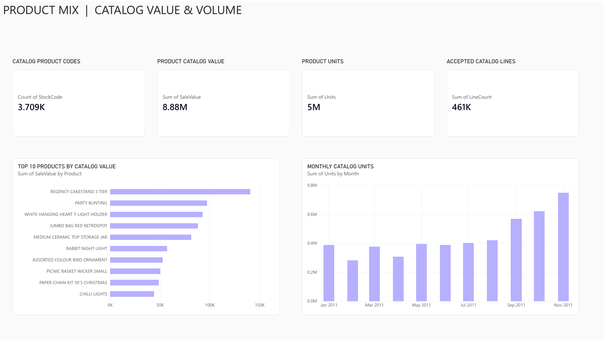
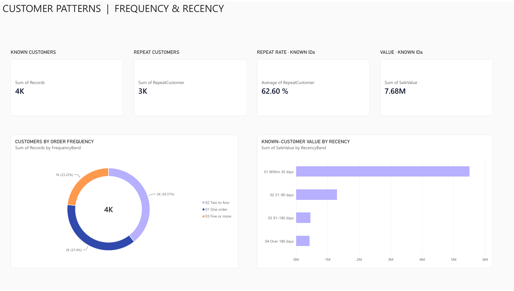

# Online Retail | Sales & Customer Insights

An interactive Power BI portfolio report on the [UCI Online Retail dataset](https://archive.ics.uci.edu/dataset/352/online+retail). It demonstrates a carefully defined KPI layer, time and geography analysis, product mix, customer frequency and recency, and reconciliation of reporting tables to the source.

**Scope:** 1 January–30 November 2011, the 11 complete calendar months in the source. Currency is GBP. Figures are **positive catalog line value**, not net revenue or profit: cancellations, returns, non-catalog charges, zero/negative prices, and incomplete boundary months are outside the headline metric.

| KPI | Result |
| --- | ---: |
| Catalog sale value | £8,877,678.99 |
| Catalog orders | 17,407 |
| Average order value | £510.01 |
| Catalog units | 4,904,971 |
| Distinct catalog product codes | 3,709 |
| Customers with a known ID | 4,168 |
| Repeat rate among known customers | 62.60% |

## Dashboard

The Power BI report has three interactive pages. Selecting a month in the overview changes its order-based KPI cards; selecting a product or customer band explores the matching aggregate view. The three import tables represent different grains of the same transactions, so selections do not automatically travel between pages. See the [interaction guide](docs/interaction-guide.md) for the exact behavior and definitions.

[Open the interactive Power BI report](https://app.powerbi.com/groups/e6426da3-9b36-4519-acf1-2434daa552ae/reports/3587db61-9c40-4164-9f7e-d2c5e05971cb) in the author's workspace. Power BI sign-in and workspace access may be required. The verified page previews and [three-page PDF export](visuals/online-retail-report.pdf) below are available to everyone on GitHub.

| 01 Retail Overview | 02 Product Mix | 03 Customer Patterns |
| --- | --- | --- |
| KPI cards, monthly trend, country contribution | Product KPIs, top ten, monthly units | Repeat rate, frequency, recency |
|  |  |  |

**Interaction check:** Selecting January in the monthly trend changed catalog sale value from £8.88m to £671.91k and average order value from £510.01 to £621.57; clearing the point restored the full-period cards. The [report guide](docs/interaction-guide.md) explains how to reproduce that check.

## Findings

- Catalog sale value reached **£1.458m in November**, the highest complete month; it was about **2.17× January's £0.672m**. This is an observed pattern, not evidence of its cause.
- The United Kingdom contributed **84.12%** of catalog sale value, so a single country dominates the aggregate trend.
- Of **4,168 known customers**, **2,609** placed more than one catalog order in the period. The rate excludes missing customer IDs.
- Customer IDs are missing for **6.75% of orders** representing **13.49% of catalog sale value**. Customer segment views therefore cover a smaller base than sales views.

See [findings and limitations](reports/findings.md) for definitions, data-quality decisions, and decision implications.

## Reproduce the analysis

1. Install `requirements.txt` in a Python environment.
2. Run `python scripts/analyze.py`. The script downloads the UCI ZIP from the official source, verifies its shape, generates three Power BI import tables and summary files, then reconciles the order and product totals independently with SQLite.
3. Load `data/orders.csv`, `data/product-month.csv`, and `data/customers.csv` into Power BI as separate tables. [Model guide](docs/model-guide.md) lists types, grains, measures, and the treatment of multiple table totals.

The source ZIP is excluded from Git because it can be downloaded directly from UCI. The smaller, derived import tables are committed so reviewers can inspect the report inputs. The [source and license note](docs/source-and-license.md) records attribution and the CC BY 4.0 license.

## Repository contents

| Path | Purpose |
| --- | --- |
| `scripts/analyze.py` | Repeatable source cleaning, aggregation, checks |
| `data/orders.csv` | One row per accepted catalog order |
| `data/product-month.csv` | One row per month and catalog product code |
| `data/customers.csv` | One row per known customer |
| `reports/` | Reconciled metrics, supporting tables, and narrative |
| `docs/` | Source, model, and interaction documentation |
| `visuals/` | Verified Power BI page previews and report PDF |

**Portfolio note:** This is historical transactional data. It is suited to demonstrating analytical methods and Power BI skills, not to current operating decisions.
